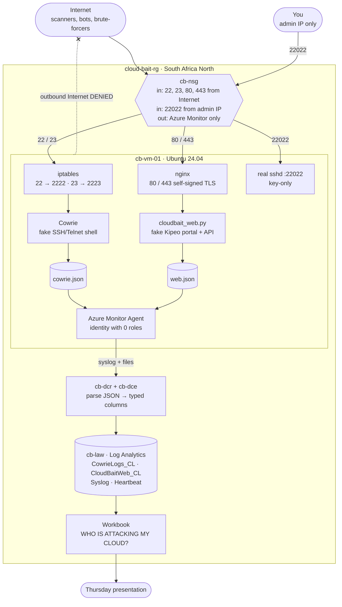
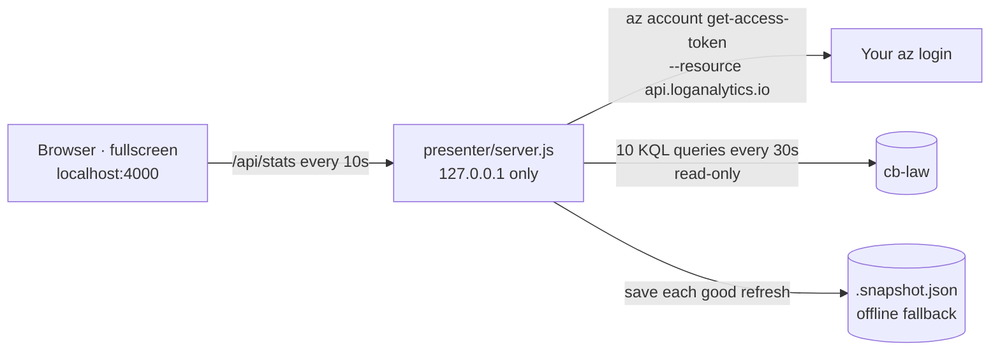

# Operation: Cloud Bait

A controlled Azure honeypot. It collects real internet attack telemetry for the Thursday 15 Oct 2026 cloud security session.

**The VM is disposable. The telemetry is the asset.** Delete `cloud-bait-rg` after the presentation.

## How it works



More diagrams:

- [docs/architecture.md](docs/architecture.md): components, network boundaries and the identity model
- [docs/how-it-works.md](docs/how-it-works.md): the path of an SSH attack, a web probe and a log line
- [docs/operations.md](docs/operations.md): deployment phases, experiment timeline and kill switch

## What's deployed

| Resource | Name | Notes |
|---|---|---|
| Resource group | `cloud-bait-rg` (South Africa North) | Tagged `delete-after=2026-10-16` |
| VNet / subnet | `cb-vnet` 10.50.0.0/16 / `cb-subnet` 10.50.1.0/24 | No peering, VPN or private endpoints |
| NSG | `cb-nsg` | See [Network rules](#network-rules) |
| VM | `cb-vm-01`, Ubuntu 24.04, Standard_B2als_v2 | System-assigned identity used **only** by the Azure Monitor Agent, with **no role assignments** |
| Public IP | `cb-public-ip` | Static |
| Log Analytics | `cb-law` | Tables: `Syslog`, `Heartbeat`, `CowrieLogs_CL`, `CloudBaitWeb_CL` |
| DCE / DCR | `cb-dce` / `cb-dcr` | Syslog plus the two honeypot log files |

### On the VM

| Port (public) | Service | Log |
|---|---|---|
| 22 | Cowrie SSH (iptables 22 → 2222) | `/home/cowrie/cowrie/var/log/cowrie/cowrie.json` → `CowrieLogs_CL` |
| 23 | Cowrie Telnet (iptables 23 → 2223) | same |
| 80 / 443 | nginx (self-signed TLS) → fake "Kipeo Digital Services" app on 127.0.0.1:8080 | `/var/log/cloudbait/web.json` → `CloudBaitWeb_CL` |
| 22022 | **Real** sshd (key-only, no root), open to your IP only | `Syslog` (auth) |

Cowrie's fake host is `kd-api-prod01`, presented as Debian 11. The web app serves synthetic routes (`/`, `/login`, `/admin`, `/api/v1/*`, `/backup/*`, `/.env`, `/config.json`, `/robots.txt`). Its data is harmless: no real people and no credentials.

## Layout

```
app/cloudbait_web.py     fake web app (stdlib Python, logs every request as JSON)
vm/setup.sh              VM provisioning (sshd move, Cowrie, iptables, nginx, app)
vm/cowrie.cfg            Cowrie persona/config
vm/nginx-cloudbait.conf  nginx reverse proxy + TLS
infra/deploy.sh          az CLI phases: network | vm | monitor | egress | expose | status
infra/dcr.template.json  DCR: Syslog + custom text logs with KQL transforms
infra/table-*.json       custom table schemas
infra/kql.sh             run KQL from the terminal
queries/*.kql            dashboard panels 01–11
tests/selftest.sh        end-to-end test (services + ingestion)
presenter/               live slide deck (server.js + index.html), local only
keys/                    admin SSH key (keep private, do not commit)
```

## Day-to-day

```bash
export MSYS_NO_PATHCONV=1                     # Git Bash on Windows
infra/deploy.sh status                        # NSG rules + IP
tests/selftest.sh                             # full end-to-end check
infra/kql.sh -f queries/01_total_activity.kql
ssh -p 22022 -i keys/cloudbait_ed25519 -o UserKnownHostsFile=keys/known_hosts cloudbaitadmin@<ip>
```

If your home IP changes, update `Allow-Admin-SSH` in the NSG and the `excluded` list in `queries/*.kql`.

## Presenter (live slides)

```bash
node presenter/server.js        # or double-click presenter/start.cmd
# open http://localhost:4000, press F for fullscreen, use ← → or a clicker
```

Eleven slides pull live numbers from `cb-law` every 30 seconds: intro, time to first attack, counters, live feed, hourly chart, credentials, URLs, commands, countries, "the twist" and the finale.

- **Local only.** The server binds `127.0.0.1`, so nobody else on the venue network can open it.
- **Read-only token.** It reuses your `az login`, but requests a token for the Log Analytics query API only. No secrets are stored.
- **Offline-safe.** Each refresh saves `presenter/.snapshot.json`. If Wi-Fi drops, the slides keep the last numbers and the pill shows `OFFLINE · DATA AS OF …`.
- **Privacy.** Attacker IPs are masked (`77.91.x.x`), and all attacker text is rendered as plain text, never as HTML.
- Jump to a slide with keys `1`–`9` or with `http://localhost:4000/#5`.



## Network rules

Inbound: `Allow-Admin-SSH` (22022, your IP) and `Honeypot-Ingress` (22, 23, 80, 443). `Honeypot-Ingress` is limited to your IP until `infra/deploy.sh expose` switches it to `Internet`.

Outbound: allow `AzureMonitor`, `AzureResourceManager` and `AzureActiveDirectory`, then **deny Internet**. A compromised box can't be used to attack others. Cowrie's emulated `wget`/`curl` also can't fetch payloads, though the commands and URLs are still logged. For maintenance (apt), run `infra/deploy.sh egress-open`, then `infra/deploy.sh egress` again afterwards.

## Kill switch

- Something unexpected (outbound spikes, unknown processes): `az vm deallocate -g cloud-bait-rg -n cb-vm-01`
- After the presentation: `az group delete -n cloud-bait-rg --yes`

There is deliberately no daily auto-shutdown, because it would break data collection every night.

## Experiment notebook

- Exposure time: see `EXPOSURE_TIME.txt` (written by `infra/deploy.sh expose`)
- Hypothesis: internet-facing cloud workloads receive automated reconnaissance and authentication attempts shortly after exposure.
- Daily: run `queries/01`, `02`, `05`, `06` and note the totals and anything interesting. Don't change the environment.
