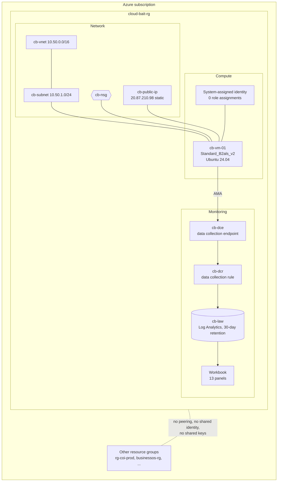
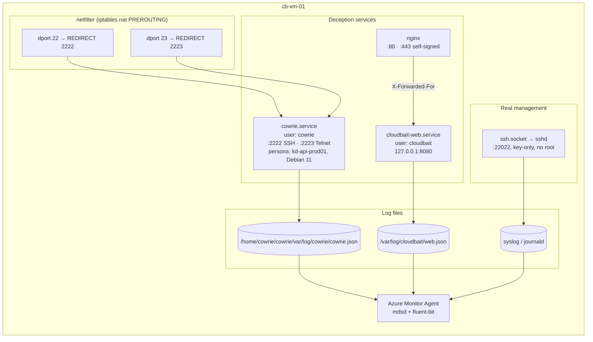
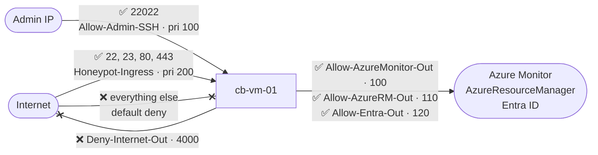
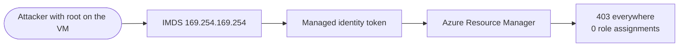

# Architecture

Operation: Cloud Bait is one disposable Ubuntu VM that pretends to be an interesting production server. Everything it observes is shipped to Log Analytics, which keeps the evidence even if the VM is compromised or deleted.

## Components

| Layer | Choice | Why |
|---|---|---|
| Isolation | Dedicated resource group and VNet, no peering | One `az group delete` removes everything. No path to production. |
| Identity | System-assigned identity with **zero** roles | AMA needs it to authenticate. A stolen token can do nothing. |
| Compute | One small VM | The VM is bait, not a workload |
| Telemetry | AMA + DCR → Log Analytics | Evidence leaves the box within about a minute |

## Inside the VM

Hardening details:

- Cowrie and the web app run as unprivileged users. Their systemd units use `NoNewPrivileges` and `ProtectSystem=strict`, and can write only to their own log directories.
- The web app uses only the Python standard library, so there are no third-party packages to exploit.
- Nothing on the box is real: the "customer", "employee" and "transaction" files contain placeholder IDs, and `.env` has no secrets.

## Network boundaries

The outbound deny matters most. A compromised honeypot can't be used to attack anyone else, and Cowrie's emulated `wget`/`curl` can't pull payloads. The attempted commands and URLs are still logged.

Known gap: DNS lookups go through Azure's platform resolver (168.63.129.16), which NSGs can't filter. That's acceptable for a short experiment.

## Identity model

This is a lesson for the talk: *a workload should have only the permissions it needs.* This one needs none.
