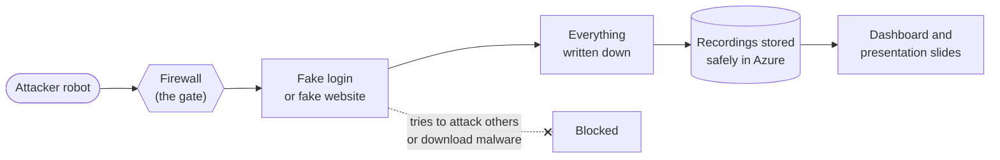
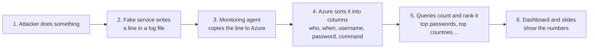

# Cloud Bait, explained simply

No jargon needed. This is the whole project from start to finish, in plain words.

---

## 1. The idea in one sentence

We put a **fake computer** on the internet, made it look **valuable**, and **recorded everyone who tried to break in**.

That fake computer is called a **honeypot**: like a pot of honey left out to see which bees show up.

---

## 2. Why bother?

People often think, *"Nobody would attack me, I'm not important."*

This experiment tests that. We never told anyone the computer's address. If attacks still arrive, that proves something important:

> **Attackers don't pick you. Robots scan the whole internet, all day, and attack whatever they find.**

The first attack arrived **4 minutes and 48 seconds** after the computer went online.

---

## 3. The pieces, using a house as a comparison

Imagine we built a **fake house** to catch burglars.

| In the house story | In our setup | What it really is |
|---|---|---|
| The neighbourhood | **Azure** | Microsoft's cloud, where we rent computers |
| A plot of land, fenced off from our real houses | **`cloud-bait-rg`** | A separate "folder" in Azure holding only this experiment |
| The fake house | **The VM** (`cb-vm-01`) | A small rented computer running Linux |
| The front gate with a guard | **The NSG** | A firewall deciding which doors are open |
| A fake front door that leads to a stage set | **Cowrie** | Fake login software. Burglars think they got in, but they're inside a simulation. |
| A fake shop window full of "valuables" | **The fake website** | A pretend company site, "Kipeo Digital Services", with tempting-looking files |
| Security cameras | **Azure Monitor Agent** | A program that copies every log line off the computer |
| The off-site recording room | **Log Analytics** (`cb-law`) | Where all the recordings are stored, safely away from the house |
| The TV screen in the security office | **The workbook** and **the presenter slides** | Dashboards that turn recordings into charts and numbers |

The key idea:

> **The house is disposable. The recordings are the treasure.**
> Even if a burglar wrecks the house, the camera footage is already stored somewhere else.

---

## 4. What happens when an attacker shows up

### Story A: a robot tries to log in

1. A robot somewhere (say, a hijacked server in Bulgaria) is scanning millions of internet addresses.
2. It finds our computer and knocks on **door 22**, the standard door for remote logins (SSH).
3. Our firewall lets it through, because we *want* to watch.
4. Inside, the knock is quietly redirected to **Cowrie**, the fake login program.
5. The robot guesses a username and password, like `root` / `admin`.
6. Cowrie says *"Welcome!"*, but it's a stage set. The robot is now typing into a **pretend computer**.
7. The robot runs its usual script: *"What machine is this?"*, *"Download my malware"*…
8. Cowrie writes down every guess and every command.
9. The download fails, because our computer **isn't allowed to talk to the internet** on its own.
10. About a minute later, all of it appears in Log Analytics and on our dashboard.

### Story B: a robot browses the fake website

1. A different robot visits the fake website (doors 80 and 443).
2. It goes straight for files that often contain passwords by accident, like **`/.env`** or **`/backup/`**.
3. Our fake site happily serves them, but they contain **nothing real**. The "customer list" is three made-up numbers.
4. If it tries to log in on the admin page, we record the username and password it tried, then say "Invalid password."
5. Everything is recorded and sent to the dashboard.



---

## 5. How do we keep it safe?

A honeypot invites attackers in, so safety matters. Here are the five locks we used:

1. **It's fake all the way down.**
   Attackers who "log in" are inside a simulation (Cowrie), not the real computer. The data is made up. There are no real passwords anywhere.

2. **It's on its own island.**
   The experiment lives in a separate area of Azure, with **no connection** to the user's real projects. Think of a house on its own plot, with no shared walls or doors with the real houses.

3. **It has no keys to anything.**
   In Azure, computers can be given "permissions" (keys). This one has **zero**. Even if an attacker took full control, they'd find nothing to unlock.

4. **It can't call out.**
   The computer is **not allowed to start connections to the internet**. A captured honeypot therefore can't be used to attack other people, and attackers can't download their tools onto it.

5. **The real door is hidden and locked.**
   We manage the computer through a *different* door (port 22022). Only the user's own internet address can reach it, and only with a private key file, never a password.

And if anything ever looks wrong, there's a **kill switch**: one command turns the computer off, and the recordings are already safe.

---

## 6. How the information reaches the screen



It's like a security guard writing in a notebook (log file), photocopying each page to head office (monitoring agent), where a clerk files it neatly into a spreadsheet (Log Analytics). The boss then reads the summary charts (dashboard).

---

## 7. How we built it, in order

We set things up carefully so that the cameras were running **before** we opened the doors:

1. **Fenced off the land.** Created the separate Azure area, network and firewall, with every door closed to everyone except the user.
2. **Built the house.** Created the small Linux computer.
3. **Furnished it with fakes.** Moved the real login door to a secret number, installed the fake login (Cowrie) and the fake website.
4. **Installed the cameras.** Set up the monitoring agent and the storage for recordings.
5. **Tested everything.** Pretended to be an attacker ourselves and checked that every action showed up in the recordings. All 15 checks passed.
6. **Locked the back door.** Blocked the computer from calling out to the internet, then tested again.
7. **Opened the front doors to the world** on **Sunday 11 October 2026 at 09:07 (Nairobi time)**, and wrote down the exact moment.
8. **Waited**, but not for long: **4 minutes 48 seconds**.

---

## 8. What we've seen so far

In the first hour or so:

- Hundreds of login attempts, mostly with lazy passwords like **`admin`**, **`123456`** and **`root`**
- Robots from **12 countries**: Bulgaria, South Korea, Romania, India, China, Canada, Russia and more
- Robots typing commands like `uname` ("what kind of machine is this?") and `/bin/busybox HISILICON`, a test used by botnets that hijack **home routers and security cameras**
- A web robot looking for **`.env.development`**, a file that sometimes accidentally contains passwords

**An important point for the talk:** the countries are where the *machines* are, not where the *people* are. Most attacking computers are themselves hacked devices or cheap rented servers. Attackers hide behind other people's computers.

---

## 9. The tools for showing it off

| Tool | What it is | When to use it |
|---|---|---|
| **Azure workbook** | A dashboard inside the Azure website | Checking in daily, digging into details |
| **Presenter slides** (`localhost:4000`) | Our own full-screen slide show with live numbers | The Thursday presentation |
| **The fake website** (`http://20.87.210.98`) | What the attackers see | Showing the audience the "bait" |

The presenter runs **only on the user's laptop**, can only *read* the recordings, and keeps working with the last numbers if the internet drops.

---

## 10. The lesson for the audience

The whole experiment builds up to one message:

> **The moment something is on the internet, it is being attacked. Not eventually: within minutes.**
>
> **Security is not about hoping nobody finds you. It's about making sure that when they do, they get nothing.**

The same five locks that kept this honeypot safe protect any real cloud system:

| Honeypot lock | Real-world security idea |
|---|---|
| Fake everything | Don't keep secrets where they can leak |
| Its own island | **Network isolation**: separate important systems |
| No keys | **Least privilege**: give systems only the permissions they need |
| Can't call out | **Egress control**: limit what a system can connect to |
| Hidden admin door + key file | **Strong authentication**: no passwords to guess |
| Cameras with off-site storage | **Monitoring and logging**: you can't defend what you can't see |

---

## 11. When it's over

After the Thursday presentation, everything gets deleted with one command:

```bash
az group delete -n cloud-bait-rg --yes
```

That removes the fake house, the fence, the cameras and the recordings, so **save screenshots first.**
