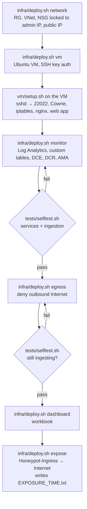
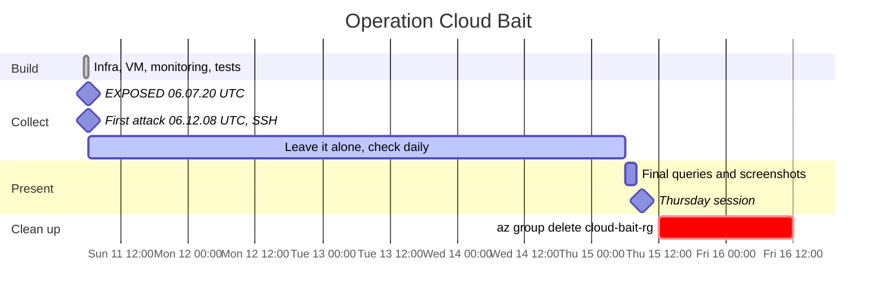
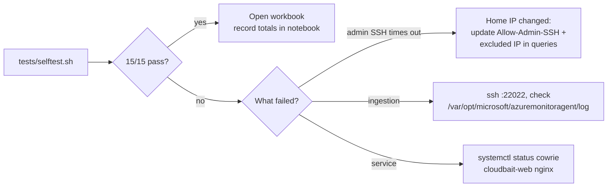
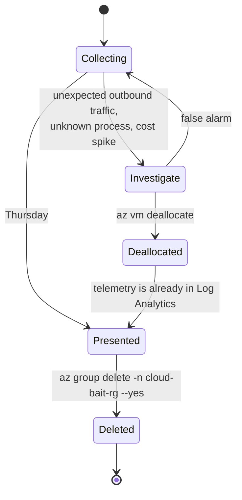

# Operations

## Deployment phases

Everything was built in this order, so that monitoring was verified **before** anything was exposed.

## Experiment timeline

**Time to first attack: 4 min 48 s.** The NSG opened at 06:07:20Z. The first SSH connection came from 77.91.71.92 at 06:12:08Z.

## Daily check

## Kill switch

Deallocating the VM loses nothing that matters: the evidence is already in `cb-law`. Delete the whole resource group after the talk. That removes the VM, network, workspace and dashboard together, so export screenshots or query results first.
